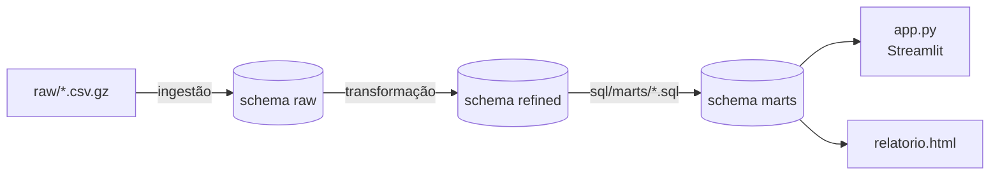

# Olist · visão da operação

Pipeline de dados em Python + DuckDB sobre o [dataset público de e-commerce da Olist](https://www.kaggle.com/datasets/olistbr/brazilian-ecommerce): cerca de 100 mil pedidos feitos entre 2016 e 2018. O resultado é um painel Streamlit e um relatório HTML estático.

Tudo mora num arquivo só, o `olist.duckdb`, em três schemas:

| Schema | O que guarda | Quem escreve |
|---|---|---|
| `raw` | O dado como chegou: nove tabelas, tudo texto. | [Ingestão](pipeline/ingestao.md) |
| `refined` | Oito tabelas com nomes em português e tipos declarados. | [Transformação](pipeline/transformacao.md) |
| `marts` | Uma tabela por pergunta de negócio, uma por arquivo `.sql`. | [Marts](pipeline/marts.md) |

## Princípios

- **Cada etapa tem uma fronteira.** `raw` não corrige nada; `refined` converte tipo mas não decide fato de negócio; a regra de negócio mora inteira nos arquivos `.sql`.
- **Falha alta em vez de erro silencioso.** Arquivo faltando, conversão que falha, duplicata conflitante, mart vazio: o pipeline para e diz onde. Um dashboard errado que parece certo é o pior resultado possível.
- **Reexecutar não tem custo.** Toda tabela é recriada, nunca acrescentada. Rodar dez vezes dá o mesmo que rodar uma.
- **O painel não calcula.** Número novo na tela exige um mart novo.

!!! info "SPECs no código"
    Cada módulo Python traz no docstring a sua **SPEC**: as regras que segue e, para cada uma, *por que* ela existe. Estas páginas resumem essas regras; o docstring é a fonte.

## Por onde começar

- [Como rodar](como-rodar.md): instalar, rodar o pipeline e abrir o painel.
- [Catálogo de marts](marts.md): as 12 perguntas de negócio e a SQL de cada uma.
- [Painel e relatório](painel.md): o que aparece na tela e de onde vem cada número.
