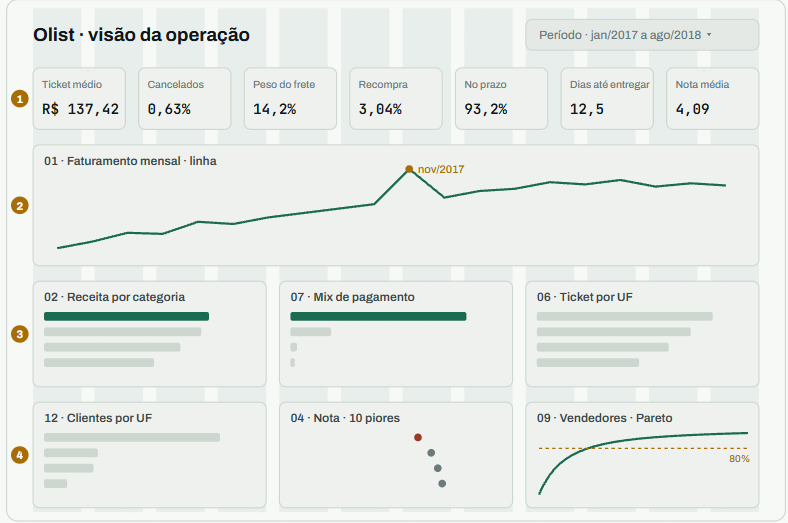

# Painel e relatório

O painel tem duas saídas, com as mesmas funções de gráfico:

| Arquivo | Saída | Comando |
|---|---|---|
| `app.py` | Página Streamlit com filtro de período | `uv run streamlit run app.py` |
| `olist/relatorio.py` | `reports/relatorio.html`, um arquivo só, sem filtro | `uv run python -m olist.relatorio` |

`olist/painel.py` concentra a leitura dos marts, a formatação e os gráficos Plotly, e não importa `streamlit`. Por isso o relatório HTML reaproveita as mesmas funções.



## Layout

**Cabeçalho.** Título à esquerda; filtro de período à direita.

**Faixa 1: sete cartões.**

| Cartão | Origem | Valor esperado |
|---|---|---|
| Ticket médio · receita por pedido | `kpis.ticket_medio` | R$ 137,42 |
| Cancelados · % de todos os pedidos | `kpis.pct_cancelados` | 0,63% |
| Peso do frete · % do frete no valor pago | `kpis.pct_frete` | 14,2% |
| Recompra · % de clientes com 2+ pedidos | `100 - recompra.pct_clientes` (linha de 1 pedido) | 3,04% |
| No prazo · % dos entregues | `entrega_no_prazo.pct_no_prazo` | 93,2% |
| Dias até entregar · média, da compra à entrega | `kpis.dias_entrega` | 12,5 |
| Nota média · avaliações de 1 a 5 | `kpis.nota_media` | 4,09 |

**Faixa 2.** Faturamento mensal, linha com marcadores, largura inteira.

**Faixa 3.** Receita por categoria (top 10) · mix de pagamento · ticket médio por UF.

**Faixa 4.** Clientes por UF · nota por categoria (10 piores) · concentração de vendedores, com linha tracejada em 80%.

## O painel não calcula

Em `olist/painel.py` e `app.py` é proibido agrupar, somar, tirar média, contar, juntar tabelas, pivotar ou fazer conta entre colunas. É permitido ordenar, filtrar linhas, `head(n)`, renomear coluna e formatar texto.

Número novo na tela exige um `.sql` novo em `sql/marts/`. Se faltar algum número, o que falta é um mart, não uma linha de pandas.

!!! note "Exceção única"
    Recompra = `100 - recompra.pct_clientes` da linha `pedidos_por_cliente = 1`, porque o mart 05 guarda o complemento.

## Filtro de período

Um `st.select_slider` com os meses de `vendas_mensais`, de jan/2017 a ago/2018 por padrão. Ele recorta só as linhas do gráfico de faturamento; os cartões e os outros gráficos valem para o período inteiro, e a página diz isso embaixo do filtro.

Recortar linha é um `SELECT`; recalcular cartão por período seria regra de negócio fora do SQL.

## Formatação

Funções puras, sem locale do sistema, para o resultado não depender da máquina de quem roda:

```python
reais(1003862.14)   # "R$ 1.003.862,14"
pct(93.2)           # "93,2%"
numero(96470)       # "96.470"
```

## Cache e erros

A leitura usa `st.cache_data`, e o botão *Recarregar dados* limpa o cache para trazer os marts novos sem reiniciar a página.

Sem o `data/olist.duckdb` (por exemplo, no primeiro deploy, já que o banco não vai para o git), o app roda ingestão, transformação e marts uma vez por processo, com `st.cache_resource`. Se a geração falhar, o arquivo pela metade é apagado e a página mostra o erro.

Faltando algum mart, a página mostra quais faltam e o comando `uv run python -m olist.pipeline.marts`.

A conexão é aberta em modo somente leitura e fechada dentro de `ler()`, para o pipeline conseguir gravar com o painel de pé.
